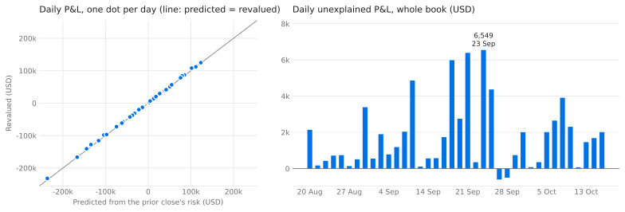
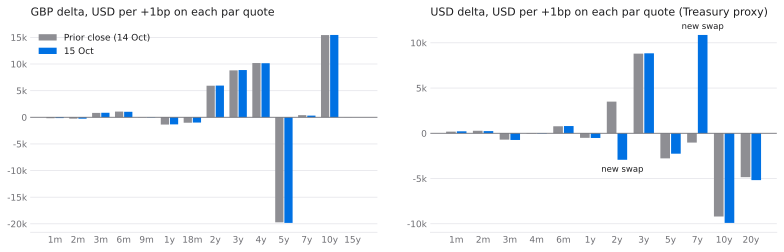
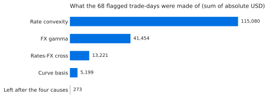

# rates-fx-desk-analytics

Valuation, risk and P&L for a book of GBP and USD rates and GBP/USD FX
derivatives. Two runs share the same curves and pricers.

**Desk run** (the trading desk's daily checks): a delta ladder by par quote
and vega by expiry, each against the prior close; the day's P&L predicted from
that risk and compared with full revaluation; and a fixings and coupon check
against the published SONIA and SOFR compounded indices. Replayed over 38
business days. See [Desk report](#desk-report-14-to-15-oct-2026-real-market-moves)
and [Replay](#replay-38-business-days-20-aug-to-15-oct-2026).

<picture>
  <source media="(prefers-color-scheme: dark)" srcset="docs/img/replay-dark.svg">
  
</picture>

**Valuation run** (an independent valuation and price-challenge workflow,
modelled on what a third-party OTC valuation service does for buy-side
clients):

1. check the market data,
2. build OIS discount curves,
3. value the client's trades with its own pricers,
4. compare those values with an independent QuantLib reference,
5. compare them with the counterparties' marks and work every difference above
   tolerance down to a cause,
6. publish a daily report (markdown and Excel) and a month-end value-change
   explain.

Personal build, made with AI coding agents (Claude Code). The portfolio,
vols and dealer marks are synthetic; the curves, fixings, compounded indices
and FX spot are real public data (sources below).

```
uv sync
uv run pytest                                                   # 35 tests, offline
uv run python -m rates_fx_desk_analytics.desk 2026-10-15 --prior 2026-10-14
# -> outputs/2026-10-15/desk_report.md and .xlsx
uv run python -m rates_fx_desk_analytics.replay 2026-08-19 2026-10-15
# -> outputs/replay_2026-08-19_2026-10-15/replay.md and .xlsx
uv run python -m rates_fx_desk_analytics.cycle 2026-10-15 --prior 2026-10-14
# -> outputs/2026-10-15/valuation_report.md and .xlsx
uv run python -m rates_fx_desk_analytics.monthend 2026-08-28 2026-09-30
# -> outputs/2026-09-30/month_end_explain.md and .xlsx
```

## The book (26 synthetic trades)

| Product | Trades | Model |
|---|---|---|
| SONIA and SOFR OIS (spot, forward-start, seasoned) | 10 | Floating leg compounded in arrears: realised fixings for the current period, telescoped forwards after |
| GBP/USD FX forwards | 5 | Covered interest parity from the spot date |
| GBP/USD FX options | 5 | Garman-Kohlhagen (forward form) off a vanna-volga smile |
| GBP and USD swaptions on OIS | 4 | Bachelier (normal vol) with the OIS annuity |
| SONIA vs SOFR cross-currency basis swaps | 2 | Constant notional, quarterly, notional exchanges; no basis curve |

## Data

| Input | Source | Note |
|---|---|---|
| GBP SONIA OIS curve | Bank of England daily OIS spot curve (current month and archive) | Real |
| SONIA fixings | Bank of England IADB (IUDSOIA) | Real |
| SOFR fixings | Federal Reserve Bank of New York | Real |
| SONIA Compounded Index | Bank of England IADB (IUDZOS2) | Real; used only to check the compounding |
| SOFR Index | Federal Reserve Bank of New York | Real; used only to check the compounding |
| USD curve | US Treasury daily par yield curve | Real data used as a **proxy** for SOFR OIS par rates (no free SOFR swap quotes; swap spread ignored) |
| GBP/USD spot | ECB reference rates (EUR/USD ÷ EUR/GBP) | Real; 2:15pm CET fixing |
| FX smile (ATM, 25D RR, 25D BF) | — | Synthetic |
| Swaption normal vols | — | Synthetic |
| Portfolio, trade dates, dealer marks | — | Synthetic |

Raw downloads are cached under `data/raw/`, so every date reruns offline.

## Modules

| Module | Does |
|---|---|
| `data.py` | Fetchers for the five sources, cached to disk |
| `qc.py` | Missing business days, stale values, day-on-day jumps, zero-curve shape |
| `dates.py` | UK and US calendars, modified following, backward schedules from the unadjusted maturity, ACT/365F and ACT/360 |
| `curves.py` | Par OIS quotes from the BoE zero curve; sequential bootstrap with log-linear discount factors |
| `market.py` | Market state; FX smile (vanna-volga from ATM/RR/BF pillar strikes); swaption normal-vol grid; roll-forward for carry |
| `pricing.py` | Own pricers and bump-and-reprice PV01, FX delta, vega |
| `reference.py` | The same trades in QuantLib: `OISRateHelper` curves, `OvernightIndexedSwap`, `GarmanKohlagenProcess`, `BachelierSwaptionEngine`, `OvernightLeg` |
| `marks.py` | Dealer marks generated from planted causes, with an answer key |
| `challenge.py` | Tolerance per product, then attribution of each gap |
| `cycle.py` | The daily run and report writers |
| `monthend.py` | Month-end explain: carry, GBP rates, USD rates, FX spot, vols, new trades |
| `risk.py` | Delta ladder (each par quote +1bp, curve bootstrapped again), vega by expiry and tenor, FX delta, change against the prior close |
| `dailypnl.py` | Daily P&L: predicted from the prior close's risk against full revaluation, unexplained by trade, rate convexity measured |
| `fixings.py` | Compounded rate per accrual period against the published index, filled fixings, settled coupon amounts |
| `desk.py` | The desk run and its report writers |
| `replay.py` | The desk run over every valuation date in a window; flagged trade-days with their measured causes |
| `scripts/figures.py` | The figures on this page and the data file for the project web page |
| `vba/ChallengeLog.bas` | Excel macro: exception log ranked by size against tolerance, owner and resolution tracking, counterparty × status counts |

## Own engine vs QuantLib (2026-10-15)

| Product | Largest gap | Why |
|---|---|---|
| Curves | about 1e-14 in discount factor | — |
| OIS swaps | 0.79 USD (0.0001bp of PV01) | Calendars: QuantLib's SOFR calendar closes on Good Friday, US federal holidays do not |
| Swaptions, XCCY, FX forwards | under 1 cent | — |
| FX options | 0.016 vol pt of vega | Convention: QuantLib's Garman-Kohlhagen runs rates from today to expiry with no settlement lag; the own pricer runs the forward from spot date to delivery |

The comparison found one bug in the own engine (coupon dates rolled from the
adjusted maturity instead of the unadjusted one) and four test trades that
carried adjusted termination dates, which QuantLib turns into a one-day stub.

## Price-challenge attribution

| Cause | How it is tested | Status if it fits |
|---|---|---|
| Prior-day curves and spot | Reprice off the previous day's market | EXPLAINED |
| Fixed-leg day count (GBP) | Reprice with ACT/360 | EXPLAINED |
| Curve interpolation (GBP) | Reprice off the BoE curve's own interpolation | EXPLAINED |
| Direction booked the wrong way | Reprice the opposite side | EXPLAINED |
| Notional booked differently | Mark/our-value ratio gives an exact round notional | EXPLAINED |
| Mark at bid/offer, not mid | Gap is a fraction of a bp (or vol) against the client | LIKELY |
| Dealer vol differs | Gap ÷ vega | LIKELY |
| Spot snapshot time | Gap ÷ FX delta | LIKELY |

A cause is confirmed only if it closes at least 90% of the gap, and the closest
fit wins. Direction and notional tests only run when the trade's value is at
least twice the tolerance; below that they have no power and the report says
to check the confirmation. On the sample date, of the 26 synthetic marks, 15 carry a planted break
and 11 are clean: the attribution finds all 15 breaks and clears all 11
(`tests/test_challenge.py`). The answer key is self-generated, so this tests
the logic, not real-world accuracy.

## Month-end explain (28 Aug to 30 Sep 2026, real market moves)

GBP 5y zero +36bp, USD 5y (proxy) +60bp, GBP/USD −2.2%. Portfolio value
5.65m → 5.44m USD: carry −80k, GBP rates +229k, USD rates −66k, FX spot −158k,
new trades −128k, residual 0. Reversing the order of the FX and rates steps
moves 3–7k between them: the cross effect.

## Desk report (14 to 15 Oct 2026, real market moves)

GBP par quotes fell by up to 5bp and USD (proxy) by up to 9bp, and GBP/USD
fell 0.15%. Two USD swaps were booked on the day.

| Line (USD) | Predicted from risk | Revalued | Unexplained |
|---|---|---|---|
| Carry (revalued) | −3,319 | −3,319 | 0 |
| GBP rates | −70,008 | −69,816 | 192 |
| USD rates | 82,960 | 84,583 | 1,623 |
| FX spot | −31,573 | −31,379 | 194 |
| Vols (synthetic, static) | 0 | 0 | 0 |
| New trades, day-one value | −107,204 | −107,204 | 0 |
| Total | −129,143 | −127,135 | 2,009 |

<picture>
  <source media="(prefers-color-scheme: dark)" srcset="docs/img/delta-ladder-dark.svg">
  
</picture>

- **Risk.** The ladder moves each par quote by 1bp and bootstraps the curve
  again, so it reads in hedge instruments. The buckets add up to all quotes
  moved together within 3 USD per bp. The day's largest changes, −6.4k at USD
  2y and +11.9k at USD 7y, come almost entirely from the two new swaps.
- **P&L.** The risk is taken on the prior close rolled one day, so roll-down
  sits in carry. Every swap, forward and cross-currency swap is explained to
  within 1,000 USD. Two USD swaptions are over that threshold (+4,768 and
  −3,653), and rate convexity, measured by applying all the quote moves
  together, accounts for 98% and 99.8% of those amounts. FX gamma, the
  rates-FX cross effect and curve basis are measured the same way.
- **Fixings.** For 14 accrual periods (last settled, accruing, or paying
  within five business days) the compounded rate from daily fixings agrees
  with the rate implied by the published index to within 0.001bp. Two periods
  span Good Friday, when no SOFR is published and the previous rate is
  carried. Settled coupons are computed from the trade terms.

"Reset" here means the overnight fixings that set each coupon; reset-risk
compression runs are not modelled.

## Replay (38 business days, 20 Aug to 15 Oct 2026)

The same run for every pair of consecutive valuation dates from 19 August to
15 October 2026 (UK and US holidays drop out, as one of the curves is
missing). The window holds no coupons, deliveries or expiries, so no cash
leaves the book. New trades' day-one value is left out: it is mostly premium,
and the model does not carry premium cash.

| Measure (USD, existing book) | Value |
|---|---|
| Sum of absolute daily P&L | 2,493,124 |
| Sum of absolute daily unexplained | 69,224 (2.8%) |
| Largest daily unexplained | 6,549 (23 Sep: GBP 5y +15bp, USD 5y +16bp, GBP/USD −0.7%) |
| Trade-days over the 1,000 threshold | 68, on 21 of the 38 days |
| Largest amount left on a flagged trade-day after the four measured causes | 205 |

<picture>
  <source media="(prefers-color-scheme: dark)" srcset="docs/img/causes-dark.svg">
  
</picture>

| Product | Main cause | Trade-days | Largest unexplained |
|---|---|---|---|
| Swaptions | Rate convexity | 36 | 8,477 |
| FX options | FX gamma | 25 | 3,388 |
| OIS swaps | Rate convexity | 3 | 2,939 |
| OIS swaps | Rates-FX cross | 3 | 2,911 |
| FX forward | Curve basis | 1 | 1,071 |

What the investigation found, beyond options being non-linear:

- **Two GBP swaps over threshold on three days.** A plain swap is close to
  linear in rates, and on the days GBP rates moved 12 to 17bp its own
  convexity was about half of the miss. The rest is a cross term: the swap's
  P&L is in GBP and reported in USD, and the day's GBP P&L translated at the
  new spot sits in neither the rates ladder nor the FX delta.
- **One FX forward on a Monday.** Yesterday's curve rolled over a weekend is
  not exactly the curve its own par quotes rebuild at the standard tenors.
  The 1,071 USD is that difference on a four-month forward, and nothing else.

The book, vols and trade dates are synthetic and the vols are static, so this
shows the method on real rate and FX moves; it is not a P&L record.

## Excel macro

Import `vba/ChallengeLog.bas` into `valuation_report.xlsx` (Developer →
Visual Basic → File → Import File), save as `.xlsm`, run `BuildExceptionLog`. `BuildExceptionLogQuiet` does the same without message boxes, for scripted
runs. Verified 2026-10-16 in Excel for Mac 16.114 (run through AppleScript):
`outputs/2026-10-15/valuation_report.xlsm` holds the result, and its 15
exceptions, ranking and counterparty counts match a pandas recomputation.

## Limits

- Single-curve OIS discounting; no CSA currency choice and no cross-currency
  basis curve, so XCCY values come from spread, rates and spot only.
- USD curve is a Treasury proxy, so USD values are illustrative.
- Smile pillars use the smile-strangle shortcut (σ25 = ATM + BF ± RR/2) and
  forward deltas.
- Fixings use a zero-day lookback; SONIA swaps commonly use five days.
- The month-end and daily explains flag, rather than model, cash that leaves
  the book.
- The daily explain is first order: FX gamma and rates-spot cross effects stay
  in unexplained. Vega is a parallel move of the vol input, not per grid node.
